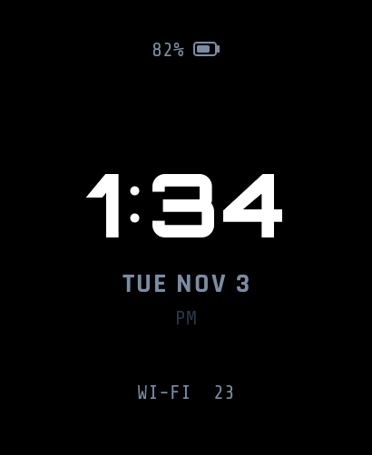
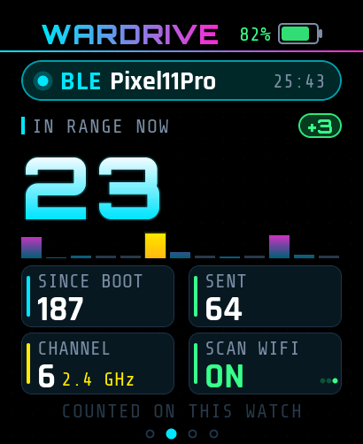
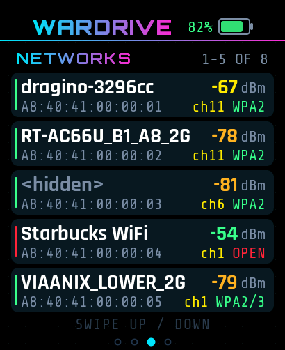
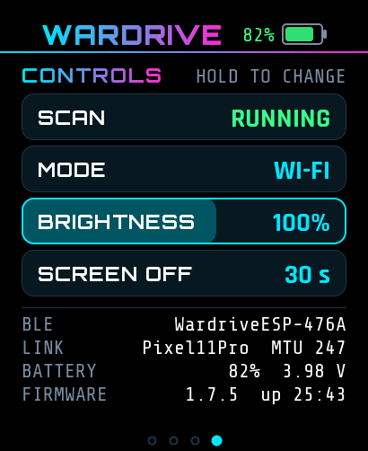

# Wardrive Go Watch

**Wardriving on your wrist.** This is [WardriveESP](https://rocketgod.dev/WardriveESP/) running on the
[Waveshare ESP32-S3 Touch AMOLED 2.06](https://www.waveshare.com/wiki/ESP32-S3-Touch-AMOLED-2.06) smartwatch. The
watch scans Wi-Fi and Bluetooth and streams what it hears to the **Wardrive Go** app on your phone. It also draws a
live dashboard on its own 410×502 AMOLED screen, and between sessions it's an ordinary clock.

<p align="center">
  
  
  
  
</p>

## What it does

- **Streams scans to Wardrive Go** over Bluetooth LE using the stock WardriveESP protocol. No pairing, and nothing to
  change in the app.
- **Three scan modes:** Wi-Fi access points, Bluetooth LE devices, and passive capture (handshakes, PMKIDs, clients).
  You can switch modes from the app, from the watch's controls page, or with the **BOOT** button.
- **Four swipeable pages:** a clock face, a live dashboard, a list of recent networks or devices, and controls.
- **Phone alerts on your wrist.** When Wardrive Go spots a tracker, drone or similar, the watch flashes a full-screen
  banner and wakes up to show it.
- **Battery and charging** come from the watch's power chip and show on every page.
- **Saves power:** the screen turns off after 15/30/60/120 s without a touch, and scanning keeps running while it's
  dark.
- **Clock that persists:** the watch's real-time clock chip keeps the time through resets and reflashes.
- **One firmware for every ESP32-S3:** the watch is recognised from its hardware at boot. Other boards running the
  same image behave exactly as stock WardriveESP.

## Quick start

1. **Get the hardware:** a [Waveshare ESP32-S3 Touch AMOLED 2.06](https://www.waveshare.com/esp32-s3-touch-amoled-2.06.htm),
   a USB-C data cable, and an Android or iOS phone with Wardrive Go
   ([Google Play](https://play.google.com/store/apps/details?id=com.rocketgod.wardrive) ·
   [App Store](https://apps.apple.com/app/id6783390938)).
2. **Build and flash** with ESP-IDF 5.5:
   ```sh
   git clone https://github.com/dopamine911/wardrive-go-watch.git
   cd wardrive-go-watch/firmware
   . ~/esp/esp-idf/export.sh
   idf.py -B build-esp32s3 -D SDKCONFIG=build-esp32s3/sdkconfig set-target esp32s3
   idf.py -B build-esp32s3 -D SDKCONFIG=build-esp32s3/sdkconfig -p /dev/ttyACM0 build flash
   ```
3. **Set the clock once** over USB ([how](docs/user-guide.md#3-set-the-clock)).
4. **Open Wardrive Go.** The watch advertises as `WardriveESP-XXXX`, and the app links to it and starts scanning.
5. **Swipe** between pages, **hold** a control to change it, and **press BOOT** to step through the modes.

> [!WARNING]
> **Don't install firmware updates for the watch from Wardrive Go or the rocketgod.dev web flasher.** They install the
> published ESP32-S3 image, which doesn't include watch support yet, so the screen goes blank until you flash this
> firmware again.

## Documentation

| Document | Read it for |
|---|---|
| [User guide](docs/user-guide.md) | Setup and a walkthrough of every feature, plus troubleshooting and known limitations |
| [Build and flash](docs/waveshare-build-flash.md) | Developer detail: toolchain, serial log, host tests, screen previews, fonts |
| [Verification record](docs/waveshare-verification.md) | What was tested on real hardware, with evidence, and what's still open |
| [Port analysis](docs/waveshare-port-analysis.md) | How WardriveESP is built and the design decisions behind the port |
| [Protocol](firmware/PROTOCOL.md) | Upstream's BLE and USB protocol: commands, output lines, OTA |
| [Upstream README](firmware/README.md) | WardriveESP's own README (all supported chips and boards) |

## Original firmware and hardware docs

| What | Where |
|---|---|
| WardriveESP home, web flasher and release notes | [rocketgod.dev/WardriveESP](https://rocketgod.dev/WardriveESP/) · [version.json](https://rocketgod.dev/WardriveESP/version.json) |
| WardriveESP source (imported here unmodified: `6b386b1` for 1.7.5, `d633973` for 1.7.6) | [WardriveESP.zip](https://rocketgod.dev/WardriveESP/WardriveESP.zip) |
| rocketgod.dev site source (flasher, binaries) | [RocketGod-git/RocketGod-git.github.io](https://github.com/RocketGod-git/RocketGod-git.github.io) |
| Wardrive Go app | [Google Play](https://play.google.com/store/apps/details?id=com.rocketgod.wardrive) · [App Store](https://apps.apple.com/app/id6783390938) · [older public source](https://github.com/RocketGod-git/wardrive-go) (predates WardriveESP) |
| Waveshare ESP32-S3 Touch AMOLED 2.06 | [Product page](https://www.waveshare.com/esp32-s3-touch-amoled-2.06.htm) · [Wiki](https://www.waveshare.com/wiki/ESP32-S3-Touch-AMOLED-2.06) · [Examples and factory image](https://github.com/waveshareteam/ESP32-S3-Touch-AMOLED-2.06) |
| ESP-IDF | [Get started (v5.5.2, ESP32-S3)](https://docs.espressif.com/projects/esp-idf/en/v5.5.2/esp32s3/get-started/index.html) |

## Status

The firmware is built on WardriveESP **1.7.6** and has been tested on one watch with one Android phone (Pixel, Wardrive
Go store build). It hasn't been tested on iPhone or with several boards linked at the same time. Each result is
recorded in the [verification record](docs/waveshare-verification.md).

## Credits and license

WardriveESP and Wardrive Go are by [RocketGod](https://rocketgod.dev/). This repository adds watch support on top of
their firmware. The firmware is MIT-licensed: see [`firmware/LICENSE`](firmware/LICENSE) and
[`firmware/NOTICE.md`](firmware/NOTICE.md), which also covers the fonts (SIL OFL 1.1). The hardware reference comes from
Waveshare's [ESP32-S3-Touch-AMOLED-2.06](https://github.com/waveshareteam/ESP32-S3-Touch-AMOLED-2.06) repository.

Scan and capture only networks you own or have permission to test. Laws on wardriving and packet capture vary by
country.
