# Wardrive Go Watch: user guide

This guide covers everything from a new watch out of the box to a working wardrive. It walks through each screen,
control and mode, then covers troubleshooting and known limitations.

**Contents**

1. [What you need](#1-what-you-need)
2. [Install the firmware](#2-install-the-firmware)
3. [Set the clock](#3-set-the-clock)
4. [Link Wardrive Go](#4-link-wardrive-go)
5. [Getting around: swipe, scroll, hold](#5-getting-around-swipe-scroll-hold)
6. [The four pages](#6-the-four-pages)
7. [Scan modes: Wi-Fi, Bluetooth, capture](#7-scan-modes-wi-fi-bluetooth-capture)
8. [Pause and resume scanning](#8-pause-and-resume-scanning)
9. [Alerts from the app](#9-alerts-from-the-app)
10. [Battery and charging](#10-battery-and-charging)
11. [Brightness and screen timeout](#11-brightness-and-screen-timeout)
12. [Firmware updates](#12-firmware-updates)
13. [Commands from a computer or the app's terminal](#13-commands-from-a-computer-or-the-apps-terminal)
14. [Troubleshooting](#14-troubleshooting)
15. [Known limitations](#15-known-limitations)
16. [Reference links](#16-reference-links)

---

## 1. What you need

| Item | Notes |
|---|---|
| [Waveshare ESP32-S3 Touch AMOLED 2.06](https://www.waveshare.com/esp32-s3-touch-amoled-2.06.htm) | ESP32-S3 with a 410×502 AMOLED touch screen, an AXP2101 power chip, a PCF85063 clock chip and a BOOT button. See the [Waveshare wiki](https://www.waveshare.com/wiki/ESP32-S3-Touch-AMOLED-2.06). |
| USB-C **data** cable | Charge-only cables don't show up as a serial port. |
| A phone with Wardrive Go | [Google Play](https://play.google.com/store/apps/details?id=com.rocketgod.wardrive) or [App Store](https://apps.apple.com/app/id6783390938). Tested so far with the Android store build only. |
| A computer with ESP-IDF 5.5 | Needed to build and flash, and to set the clock once. Tested with **v5.5.2**. [Install guide](https://docs.espressif.com/projects/esp-idf/en/v5.5.2/esp32s3/get-started/index.html). |

There's no prebuilt watch image yet, so you build it yourself. The official flashers (the
[web flasher](https://rocketgod.dev/WardriveESP/) and the app's USB flasher) install the stock ESP32-S3 image, which
doesn't drive the watch's screen.

## 2. Install the firmware

### 2.1 Build

```sh
git clone https://github.com/dopamine911/wardrive-go-watch.git
cd wardrive-go-watch/firmware
. ~/esp/esp-idf/export.sh
idf.py -B build-esp32s3 -D SDKCONFIG=build-esp32s3/sdkconfig set-target esp32s3   # first time only
idf.py -B build-esp32s3 -D SDKCONFIG=build-esp32s3/sdkconfig build
```

Each chip gets its own build directory, so an ESP32-S3 build never overwrites another chip's `sdkconfig`. A good build
ends with `wardrive_bridge.bin binary size … (30%) free`. You'll also see three `-Wunused-function` warnings
(`text_c`, `led_apply`, `board_is_awok`). The unmodified upstream source has them too.

### 2.2 Flash

Plug the watch in with USB-C. On Linux it shows up as `303a:1001`, usually at `/dev/ttyACM0`. Your user needs access
to the port (on most distributions, membership in the `dialout` group).

```sh
python -m esptool --chip esp32s3 -p /dev/ttyACM0 erase_flash      # first time only
idf.py -B build-esp32s3 -D SDKCONFIG=build-esp32s3/sdkconfig -p /dev/ttyACM0 flash
```

> [!NOTE]
> The first flash **erases Waveshare's factory demo**. To go back to it, write Waveshare's
> [factory image](https://github.com/waveshareteam/ESP32-S3-Touch-AMOLED-2.06/raw/30f3b23b3d4bb38d32f7d0cddffb66759668a855/firmware/ESP32-S3-Touch-AMOLED-2.06_FactoryOnly_20261016.bin)
> at `0x0`.

Later reflashes don't need the erase. They also keep your clock, brightness and screen-off settings.

### 2.3 First boot

A splash screen shows, then the clock face (page 1). To watch the boot log without resetting the watch:

```sh
idf.py -B build-esp32s3 -D SDKCONFIG=build-esp32s3/sdkconfig -p /dev/ttyACM0 monitor --no-reset
```

A healthy boot includes:

```
WardriveESP: watch probe: AXP2101 IC type 4a, 4 of 4 board parts answered
WardriveESP: board: Waveshare AMOLED 2.06
WardriveESP: lcd: 410x502 CO5300 running
WardriveESP: advertising as 'WardriveESP-XXXX'
```

These lines are harmless:

- `Detected size(32768k) larger than the size in the binary image header(4096k)`: the watch has 32 MB of flash and
  the image uses upstream's 4 MB layout.
- Two `i2c.master: probe device timeout` errors: the board scans every I2C address at boot.

> [!TIP]
> Plain `idf.py monitor` and most serial terminals **reset the watch** when they open the port, which drops the
> phone's link. Use `--no-reset`, or a tool that opens the port with DTR and RTS both off.

## 3. Set the clock

<p align="center">
  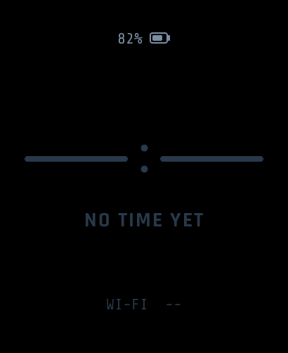
  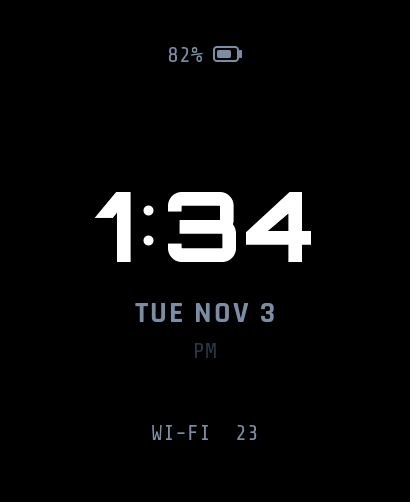
</p>

The watch's clock chip starts blank, so the clock face shows **NO TIME YET**. Wardrive Go doesn't send the time, so you
set it once from a computer. The chip then keeps it through resets and reflashes.

**Option A: a one-off script (recommended).** Run this from the ESP-IDF environment (`. ~/esp/esp-idf/export.sh`),
which already includes `pyserial`. It opens the port without resetting the watch, sets the clock to the computer's
time, reads it back, and closes the session:

```sh
python - /dev/ttyACM0 <<'EOF'
import sys, time, serial
p = serial.Serial()
p.port, p.baudrate, p.timeout = sys.argv[1], 115200, 1
p.dtr = p.rts = False                 # open without resetting the watch
p.open()
def line():
    return p.readline().decode(errors="replace").strip()
for _ in range(10):                   # the port shows log text until a session opens
    p.write(b"wdusb hello\n")
    if any(line().startswith("WD:CAPS") for _ in range(5)):
        break
else:
    sys.exit("no WD:CAPS reply: is this the watch, and is the app not holding it over USB?")
p.write(f"time {int(time.time())}\n".encode())
time.sleep(0.5)
p.write(b"time\n")
for _ in range(20):
    l = line()
    if l.startswith("WD:TIME"):
        print(l)                      # expect set=1 and now= close to `date +%s`
        break
p.write(b"wdusb bye\n")
p.close()
EOF
```

**Option B: by hand** in a serial terminal opened without a reset (DTR and RTS off):

```
wdusb hello
time 1793736556        # the output of `date +%s` on your computer
time                   # replies WD:TIME now=… set=1
wdusb bye
```

While the USB session is open, the watch drops the phone and turns Bluetooth off. Once you send `wdusb bye` (or after
60 s of silence) it advertises again, and Wardrive Go relinks by itself.

**Option C: from Wardrive Go's terminal.** The same command, `time <unix seconds>`, also works over Bluetooth because
it goes through the same command handler as USB. This hasn't been tried from the app yet.

### Time zone

The chip stores UTC. The face shows it in the time zone compiled into the firmware: by default America/Chicago, with
automatic daylight saving. For another zone, change the `WATCH_TZ` `#define` next to `watch_clock_init()` in
`firmware/main/wardrive_bridge.c` to a POSIX TZ rule and rebuild. Some examples:

| Zone | `WATCH_TZ` |
|---|---|
| America/New_York | `EST5EDT,M3.2.0,M11.1.0` |
| America/Chicago (default) | `CST6CDT,M3.2.0,M11.1.0` |
| America/Denver | `MST7MDT,M3.2.0,M11.1.0` |
| America/Los_Angeles | `PST8PDT,M3.2.0,M11.1.0` |
| Europe/London | `GMT0BST,M3.5.0/1,M10.5.0` |
| Europe/Berlin | `CET-1CEST,M3.5.0,M10.5.0/3` |
| UTC | `UTC0` |

On Linux, `tail -1 /usr/share/zoneinfo/<Area/City>` prints the rule for any zone.

## 4. Link Wardrive Go

1. Turn Bluetooth on and open **Wardrive Go**.
2. The watch advertises as **`WardriveESP-XXXX`** (the last four hex digits of its address, also shown on the
   controls page). It needs no pairing. The app links and starts streaming.
3. The dashboard's status pill turns to **BLE** followed by your phone's name, and **SCAN WIFI** reads **ON**.
4. The networks the watch hears show up in Wardrive Go along with whatever else the app is collecting.

The watch only scans while the app is open and listening:

| Watch shows | Meaning | What to do |
|---|---|---|
| `NO PHONE`, SCAN `OFF`, controls say `NEEDS PHONE` | Nothing is linked | Open Wardrive Go near the watch |
| `BLE <phone>`, SCAN `WAITING`, controls say `OPEN THE APP` | The phone is linked but the app is in the background and hasn't subscribed yet | Bring Wardrive Go to the foreground |
| SCAN `ON` / `RUNNING` | Scanning and streaming | Nothing to do |
| SCAN `PAUSED` | You paused it from the watch (§8) | Hold SCAN to resume |

Once streaming, it keeps going with the app in the background and with the watch's screen off. If the link drops, the
phone relinks by itself.

## 5. Getting around: swipe, scroll, hold

| Gesture | What it does |
|---|---|
| **Swipe left / right** | Next / previous page. Dots at the bottom show which of the four pages you're on. |
| **Swipe up / down** | On the networks page, scroll five rows at a time. |
| **Touch and hold (0.6 s)** | Press a button on the controls page. The button fills up as you hold it and acts when it's full. |
| Tap | Does nothing, so accidental brushes don't change settings. |
| Touch while the screen is off | Wakes the screen. That touch only wakes it and never presses anything. |
| **BOOT button** | Steps to the next scan mode (§7) from any page, and wakes the screen. |

A swipe needs about 80 px of travel in under a second.

## 6. The four pages

### Page 1: clock face

<p align="center">
  
  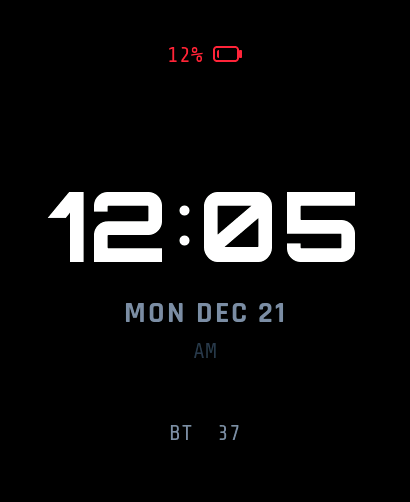
  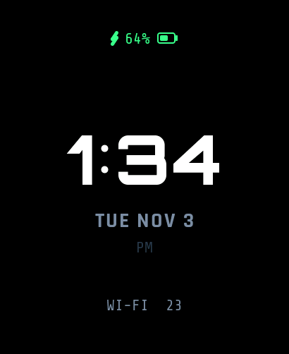
</p>

A plain watch screen showing the battery, the time, the date, AM/PM, and one small counter for the scan mode:

- **WI-FI n** or **CAP n**: access points in range now.
- **BT n**: Bluetooth devices seen in the current window.
- **`--`**: not scanning.

### Page 2: dashboard

<p align="center">
  
  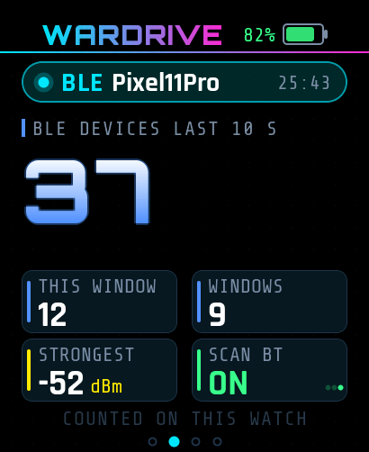
  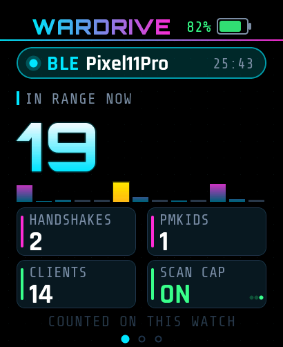
  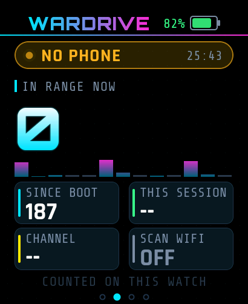
</p>

- **Header:** the WARDRIVE title, battery percent and battery cell.
- **Status pill:** what the watch is linked to (`BLE`, `USB` or `NO PHONE`), the phone's name, and the watch's uptime.
- **Big number:** what's in range now. In Wi-Fi and capture mode that's **IN RANGE NOW** (access points), with a green
  **+n** badge for new ones in the last 10 s. In Bluetooth mode it's **BLE DEVICES LAST 10 S**.
- **Channel bars** (Wi-Fi and capture): recent activity on each 2.4 GHz channel.
- **Tiles**, which depend on the mode:

| Mode | Tiles |
|---|---|
| Wi-Fi | **SINCE BOOT** (APs heard since power-on) · **SENT** (new APs sent to the phone on this link; **SEEN** when unlinked) · **CHANNEL** being scanned · **SCAN WIFI** state |
| Bluetooth | **THIS WINDOW** (devices in the current 10 s window) · **WINDOWS** completed · **STRONGEST** signal (dBm) · **SCAN BT** state |
| Capture | **HANDSHAKES** · **PMKIDS** · **CLIENTS** · **SCAN CAP** state |

"COUNTED ON THIS WATCH" is a reminder that these numbers are this watch's own count, not the app's totals.

### Page 3: networks / devices

<p align="center">
  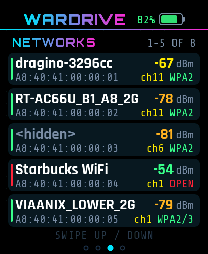
  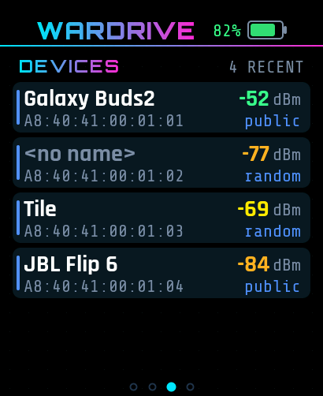
  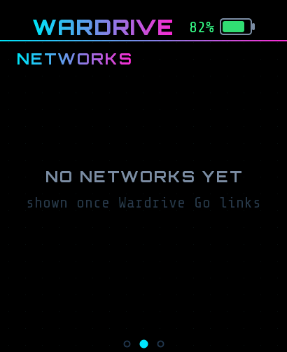
</p>

Up to 32 of the most recently heard networks, newest first, five per screen (swipe up and down to scroll):

- **Wi-Fi / capture:** SSID (or `<hidden>`), BSSID, signal in dBm, channel and security. The bar on the left shows
  security at a glance: red for open, amber for WEP/WPA, green for WPA2/WPA3.
- **Bluetooth:** the page becomes **DEVICES**: the device name (or `<no name>`), address, signal, and whether the
  address is public or random.

The list follows the current mode and starts empty with **NO NETWORKS YET** until something is heard.

### Page 4: controls

<p align="center">
  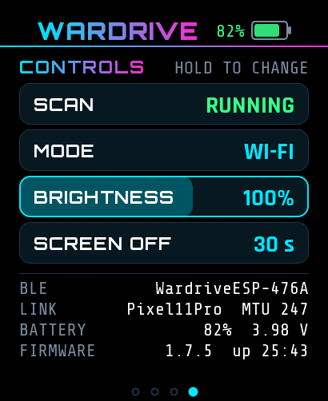
  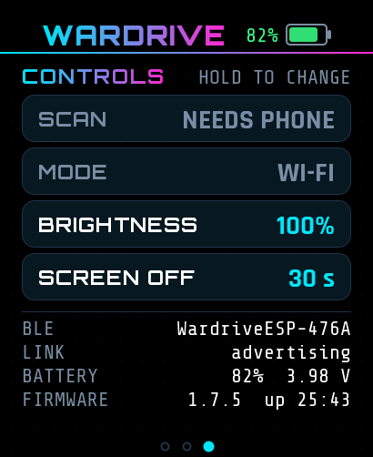
</p>

**HOLD TO CHANGE**: touch and hold a button until it fills.

| Button | Each hold | Available |
|---|---|---|
| **SCAN** | Pauses or resumes scanning (§8) | While scanning, or while the app is listening |
| **MODE** | Wi-Fi → Bluetooth → Capture → Wi-Fi (§7) | Only while the app is listening (dimmed otherwise) |
| **BRIGHTNESS** | 25% → 50% → 75% → 100% | Always (saved) |
| **SCREEN OFF** | 15 s → 30 s → 60 s → 120 s | Always (saved) |

Below the buttons:

- **BLE:** the watch's Bluetooth name.
- **LINK:** what it's linked to, with the BLE MTU, or `advertising`.
- **BATTERY:** percent and voltage.
- **FIRMWARE:** version and uptime.

## 7. Scan modes: Wi-Fi, Bluetooth, capture

| Mode | What the watch does | Reported to the app as |
|---|---|---|
| **Wi-Fi** (default) | Active scans across the 2.4 GHz channels, one at a time | Access points (`WD:AP`) |
| **Bluetooth** | BLE discovery in 10 s windows; each device is reported about once per window | Devices (`WD:BT`) |
| **Capture** | **Passive** monitor mode, staying on each channel ~300 ms | Handshakes, PMKIDs, clients, plus the APs it hears |

There are three ways to switch:

1. **BOOT button:** one press is one step (Wi-Fi → Bluetooth → Capture → Wi-Fi). It works from any page and also wakes
   the screen.
2. **MODE button** on the controls page: hold it.
3. **Wardrive Go:** the app's own board controls work as they do on any WardriveESP board.

Things to know:

- Switching only works while the app is open and listening. With no host listening, the BOOT press is ignored and
  MODE is dimmed, because the watch returns to Wi-Fi each time it links and a mode chosen before that would be lost.
- When you switch on the watch, Wardrive Go follows: it doesn't switch back. This was checked on one Android phone with
  one board linked.
- The clock-face counter, the dashboard tiles and the networks/devices list all change with the mode.

> [!IMPORTANT]
> Capture records WPA handshakes and PMKIDs. Only capture networks you own or have written permission to test.

## 8. Pause and resume scanning

Hold **SCAN** on the controls page. While scanning it reads **RUNNING** and a hold pauses it. While paused it reads
**PAUSED** and a hold resumes it. Wardrive Go follows a pause made on the watch. A pause lasts until you resume it, the
app starts the scan again, or the phone relinks.

## 9. Alerts from the app

<p align="center">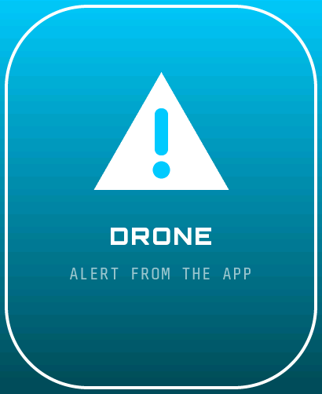</p>

When Wardrive Go raises an alert (a tracker, a drone, police and so on), it sends the watch the same `led alert …`
command it uses to flash the LED ring on other boards. The watch shows a full-screen banner in the alert's color with
its label and **ALERT FROM THE APP**, wakes the screen if it was off, and goes back to the previous page after a few
seconds (the app sets how long).

To test it from a terminal (§13): `led alert spin 00C8FF 6 DRONE`.

## 10. Battery and charging

<p align="center">
  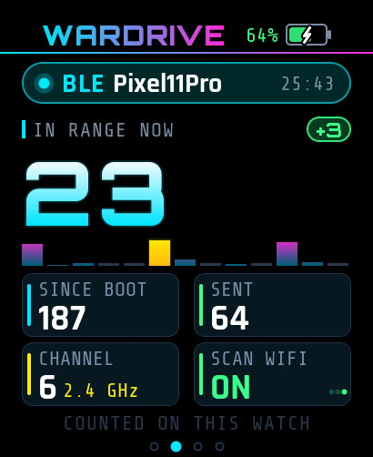
  
</p>

The battery percent and cell appear on every page. The level is read from the AXP2101 every 30 s, and the charging
state every 2 s:

- **Bolt, green percent:** charging.
- **Dim bolt:** on USB power, not charging (battery full).
- **No bolt:** on battery.
- **Cell color:** green above 40%, amber from 16 to 40%, red at 15% and below.

The level also goes to Wardrive Go (in the `WD:HEALTH` report and the board's advert). The charging state is only shown
on the watch, because the protocol has nowhere to carry it.

## 11. Brightness and screen timeout

- **Brightness:** 25 / 50 / 75 / 100% (default 100%).
- **Screen off:** after 15 / 30 / 60 / 120 s without a touch (default 30 s).

Change either on the controls page. Both are saved on the watch and survive reboots and reflashes (a full
`erase_flash` resets them). With the screen off, scanning and streaming carry on at the same rate. A touch, a BOOT
press or an alert from the app turns the screen back on.

## 12. Firmware updates

> [!WARNING]
> **Don't update the watch from Wardrive Go or the rocketgod.dev web flasher.** Both install the published ESP32-S3
> image, which doesn't support the watch yet. The watch keeps scanning, but its screen goes blank until you flash this
> firmware again over USB (§2.2).

<p align="center">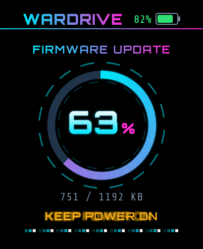</p>

To update, pull the latest code and repeat the build and flash steps (§2), without the erase. Your clock and screen
settings carry over.

If an update does arrive over Bluetooth, the watch shows a progress ring with **KEEP POWER ON**, then **INSTALLING**,
and restarts by itself. If the screen was off when the update started, the progress screen only appears after the next
touch or alert. The update itself isn't affected.

## 13. Commands from a computer or the app's terminal

The watch accepts every stock WardriveESP command. Send them from Wardrive Go's terminal over Bluetooth, or over USB in
a session (`wdusb hello` … `wdusb bye`, opened without resetting the port, see §3). The full list is in
[`firmware/PROTOCOL.md`](../firmware/PROTOCOL.md#commands). These are the most useful on the watch:

| Command | What it does |
|---|---|
| `help` | List the commands |
| `info` | Firmware, chip, MAC, uptime, last reset, memory |
| `status` | Scanning state, sweeps, APs in the last sweep, channels |
| `caps` | Capabilities line (`board=waveshare_s3_amoled_206 disp=410x502 batt=1 …`) |
| `link` | What the watch is linked to, for how long, signal |
| `bt on` / `bt off` | Bluetooth mode / back to Wi-Fi |
| `cap on` / `cap off` | Capture mode / back to Wi-Fi |
| `stop` / `start` | Stop or start scanning |
| `ch 1,6,11` / `ch all` | Limit or reset the channels |
| `time` / `time <unix seconds>` | Read or set the clock (UTC) |
| `led alert <pattern> <rrggbb> [seconds] [label]` | Show an alert banner (§9) |
| `led stealth on` / `off` | Keep the screen dark entirely, regardless of touch (saved). Read from the code; not tried on the watch |
| `drop` | Disconnect the phone so another one can link |
| `reboot` | Restart the watch |

## 14. Troubleshooting

| Symptom | Likely cause | Fix |
|---|---|---|
| Clock face says **NO TIME YET** | The clock chip was never set | §3 |
| Time is off by whole hours | Time zone | Change `WATCH_TZ` and rebuild (§3) |
| Screen stays blank after an app update | The app installed the stock S3 image | Reflash this firmware (§2.2, §12) |
| Dashboard says **WAITING** / controls say **OPEN THE APP** | The phone is linked but the app is in the background | Bring Wardrive Go to the foreground |
| **MODE** is dimmed, BOOT does nothing | No app is listening | Open Wardrive Go, then switch |
| Watch not in the app's list | A USB session is holding the watch (Bluetooth is off), or another phone has it | Send `wdusb bye` or unplug the computer. Use `drop` from the other phone |
| Watch resets every time you open the serial port | The terminal toggles DTR/RTS | `idf.py monitor --no-reset`, or open with DTR and RTS off |
| No `/dev/ttyACM0` | Charge-only cable, or no permission | Use a data cable. Add your user to `dialout` and log in again |
| Boot log says `board: generic` and the screen stays dark | The watch's parts weren't recognised at boot | Power-cycle it. If it keeps happening, capture the boot log (`--no-reset`) and open an issue |
| `Detected size(32768k) larger than …` | Expected | Harmless (§2.3) |

## 15. Known limitations

- **No standalone scanning.** The watch scans only while Wardrive Go (or a USB host) is linked and listening. It has no
  GPS, so it can't log on its own.
- **Wardrive Go doesn't set the time.** Set it once over USB (§3).
- **The time zone is built in.** Changing it, including when you travel, means a rebuild.
- **App and web-flasher updates remove watch support** until the official image includes it (§12).
- **2.4 GHz only.** The ESP32-S3 has no 5 GHz radio.
- **Charging state stays on the watch.** The battery level reaches the app; whether it's charging doesn't.
- **Tested setup:** one watch and one Android phone. iPhone and several boards linked at once are untested.
- **Unknown:** whether the clock keeps time after the battery runs completely flat with USB unplugged.
- **Screen draw rate:** the dashboard redraws about once a second. Alert banners blink a little slower than designed.
- **Battery life hasn't been measured.** How long a charge lasts in each mode is still open
  ([issue #2](https://github.com/dopamine911/wardrive-go-watch/issues/2)).

The full evidence and the list of open issues are in the [verification record](waveshare-verification.md).

## 16. Reference links

**Original firmware**
- WardriveESP home and web flasher: <https://rocketgod.dev/WardriveESP/>
- WardriveESP source (zip): <https://rocketgod.dev/WardriveESP/WardriveESP.zip>
- Release notes and latest version: <https://rocketgod.dev/WardriveESP/version.json>
- rocketgod.dev site source (flasher, binaries): <https://github.com/RocketGod-git/RocketGod-git.github.io>
- Upstream README and protocol, as vendored here: [`firmware/README.md`](../firmware/README.md),
  [`firmware/PROTOCOL.md`](../firmware/PROTOCOL.md)

**App**
- Wardrive Go: [Google Play](https://play.google.com/store/apps/details?id=com.rocketgod.wardrive) ·
  [App Store](https://apps.apple.com/app/id6783390938)

**Hardware**
- Waveshare product page: <https://www.waveshare.com/esp32-s3-touch-amoled-2.06.htm>
- Waveshare wiki (pinout, schematic, demos): <https://www.waveshare.com/wiki/ESP32-S3-Touch-AMOLED-2.06>
- Waveshare examples and factory image: <https://github.com/waveshareteam/ESP32-S3-Touch-AMOLED-2.06>

**Toolchain**
- ESP-IDF v5.5.2 get started (ESP32-S3): <https://docs.espressif.com/projects/esp-idf/en/v5.5.2/esp32s3/get-started/index.html>

**This project**
- [Build and flash (developer detail)](waveshare-build-flash.md)
- [Verification record](waveshare-verification.md)
- [Port analysis](waveshare-port-analysis.md)
